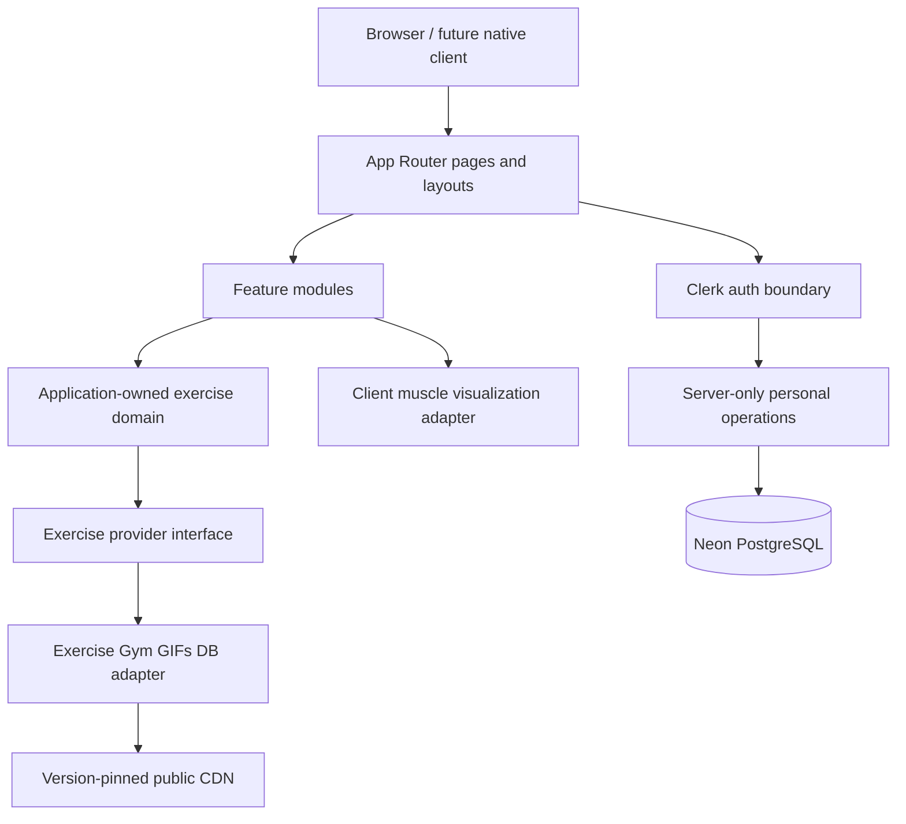

# Application Architecture

**Purpose:** Define approved technologies, application layers, rendering boundaries, and integration architecture.  
**Scope:** All application and infrastructure design.  
**Related:** [folder-structure.md](folder-structure.md), [api.md](api.md), [security.md](security.md)  
**Last reviewed:** 2026-10-29

## 1. Technology decisions

| Concern | Decision |
| --- | --- |
| Web framework | Next.js `16.4.3` App Router (current manifest) |
| Language/UI | React `19.3.0` and strict TypeScript (current manifest) |
| Authentication | Clerk `@clerk/nextjs@^7.9.21`; developer installation/configuration pending |
| Exercise source | Exercise Gym GIFs DB through a replaceable adapter; media use is license-blocked for public deployment |
| Runtime validation | Zod `^4.6.7`; developer installation pending |
| Anatomy | React Muscle Highlighter `^1.2.0`; developer installation pending |
| Icons | Hugeicons React `^1.1.10` with Core Free Icons `^4.3.5`; import icons individually |
| Typography | Outfit through `next/font/google`; no font package or external stylesheet |
| Styling | Plain CSS with semantic tokens and colocated CSS Modules; Tailwind/CSS-in-JS/UI kits are not approved |
| Database/ORM | Neon PostgreSQL with Prisma ORM 7, Prisma Neon adapter, and Neon serverless driver; pooled runtime connection and direct CLI connection |
| Deployment | Vercel-compatible design; provider/account decision pending |

No other framework, service, ORM, state library, component library, analytics SDK, or paid API may be introduced without approval.

## 2. Layer model



- **Route layer (`src/app`)** composes features, metadata, loading/error UI, and route boundaries. It contains little domain logic.
- **Feature layer (`src/features`)** owns use cases, feature UI, schemas, mappings, and tests.
- **Domain/provider layer** owns normalized models and provider contracts. UI never consumes raw provider JSON.
- **Shared UI/lib layer** contains only proven cross-feature primitives and provider-independent helpers.
- **Server layer (`src/server`)** holds secrets, authorization, and future persistence operations. It must not be imported into client bundles.

## 3. Rendering boundaries

### Server Components by default

Use Server Components for route shells, initial catalog/detail data fetching, metadata, and non-interactive presentation. This reduces browser JavaScript and keeps provider/cache policy centralized.

### Client Components only for browser state

Use a narrow `"use client"` boundary for filter controls that require immediate local interaction, animation preferences, Clerk client widgets when documented, and React Muscle Highlighter interaction. Pass serializable normalized data across the boundary. Do not mark pages or feature trees as client-side merely for convenience.

### Server Actions

Reserve Server Actions for authenticated, user-initiated mutations where they improve the form experience. Each action independently authenticates, authorizes, validates, and returns a typed result. Do not use actions as a general data-fetch API.

### Route Handlers

Use Route Handlers for explicit HTTP contracts: future native-client endpoints, webhooks, or same-origin provider facades where justified. They follow [api.md](api.md). Do not proxy public data without a caching, security, or contract reason.

## 4. Exercise provider abstraction

The application owns a contract similar to:

```ts
type ExerciseId = string;

interface ExerciseProvider {
  list(query: ExerciseQuery): Promise<ExercisePage>;
  getById(id: ExerciseId): Promise<Exercise | null>;
  facets(): Promise<ExerciseFacets>;
}
```

The concrete adapter fetches, validates, normalizes, and attributes provider records. It returns explicit errors for unavailable, malformed, and unsupported data. Domain models use application terms; provider filenames and URL construction stay inside the adapter.

Media is a separate capability within the normalized model so a future licensed MP4 provider can replace or augment GIF media without changing search, detail pages, or exercise identity.

## 5. Data flow and trust

1. Fetch only from an allowlisted, HTTPS, version-pinned provider base.
2. Validate the response at the adapter boundary before use or caching.
3. Normalize supported fields into application types.
4. Filter/search only normalized values.
5. Return safe, typed failures and render graceful states.
6. Treat remote media as untrusted third-party content and enforce [exercises.md](exercises.md) rights gates.

## 6. Authentication and persistence boundary

Clerk proves session identity; it does not confer ownership. Every future private mutation re-derives the actor server-side and scopes data access to that actor. Client-only visibility controls are never authorization.

The application user is keyed internally and has one unique Clerk user ID. The profile and dated training sessions reference that internal user. Every personal query derives the Clerk ID from the verified server session and never accepts an owner ID from the browser. Scheduled exercises store a bounded provider identity snapshot plus planned sets, repetitions per set, and weight in integer grams. They are unique per user session date and source exercise. Nullable prescription columns preserve unknown values on records created before the prescription was introduced; all new scheduling writes require them.

Prisma is server-only. Use Neon's pooled URL for application traffic and its direct URL for Prisma CLI migration work. Development and production are the only approved database environments; do not add a test, preview, branch-per-PR, or shadow database without a new decision.

## 7. Error model

Expected categories are `not-found`, `invalid-input`, `provider-unavailable`, `provider-invalid`, `media-unavailable`, `unauthenticated`, `forbidden`, and `internal`. UI copy is user-safe; server logs omit secrets and sensitive data. Provider-specific error bodies never leak directly to users.

## 8. Architectural decision discipline

Record material choices in docs before implementation. When a decision changes the approved stack, privacy posture, schema, license position, or client contract, require developer approval and update the owning rule document.

