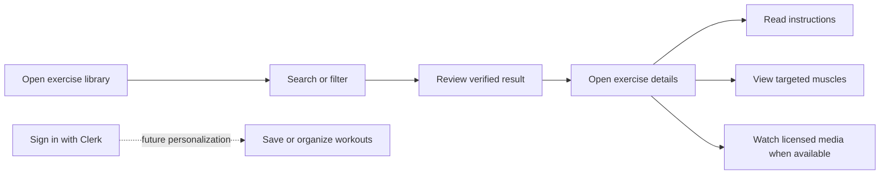
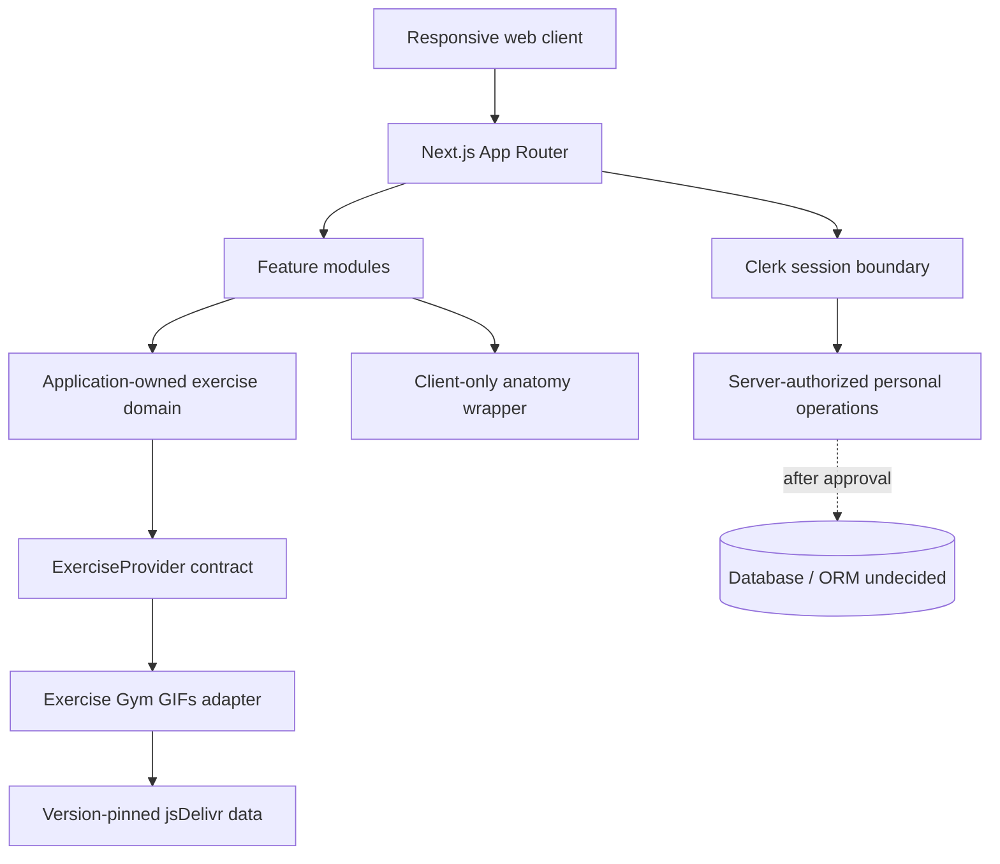

# GYM Fitness Platform

> A mobile-first exercise discovery and learning platform built with Next.js. The product name remains temporary; the logo mark, Outfit typography, and coral/navy foundation are approved.

## Project status

**The exercise-library vertical slice is implemented in code but remains unverified.** The repository contains a Next.js 16.4.3/React 19.3.0 application shell, the logo/favicon, Outfit typography, semantic light/dark tokens, a pinned exercise-provider adapter, responsive catalog/detail routes, and an accessible React Muscle Highlighter wrapper. No test, lint, type-check, build, live provider runtime, Clerk tenant, database, or deployment result is claimed to work.

| Capability | Status |
| --- | --- |
| Engineering rulebook | Implemented as documentation |
| Architecture and provider design | Implemented for the initial read-only catalog |
| Responsive Next.js foundation | Implemented in code; not built or run by an agent |
| Exercise catalog integration | Pinned adapter, Zod validation, normalization, search, filtering, pagination, and detail lookup written |
| Exercise GIF use | **Blocked for public/commercial release pending rights verification** |
| Clerk authentication | Approved approach, not configured |
| Muscle visualization | Typed mapping and accessible front/back detail component written; not browser-verified |
| Database and persistence | Pending developer decision |
| Deployment | Not configured or verified |

The authoritative rules for contributors and coding agents are in [`.agents/README.md`](.agents/README.md). Start with [AGENTS.md](AGENTS.md).

## 1. Mission and vision

GYM Fitness Platform aims to help beginners, intermediate users, and experienced fitness enthusiasts discover exercises, understand technique from verified source material, see which muscles an exercise targets, and eventually organize personal workouts.

The product should feel like a polished fitness guide rather than a generic dashboard: fast on mobile, clear under time pressure, accessible by keyboard and assistive technology, and honest about incomplete source data.

Next.js is the responsive web platform. It is not a native Android or iOS application. The architecture keeps domain contracts independent enough to support a future native client after a separate framework decision.

## 2. Problem

Exercise information is often fragmented across ad-heavy sites, inconsistent names, unexplained anatomy, inaccessible animations, and sources with unclear media rights. Users need one coherent discovery flow that preserves source truth, presents technique accessibly, and avoids inventing difficulty, muscle relationships, or medical claims.

## 3. Intended users

| User | Need |
| --- | --- |
| Beginner | Plain-language discovery, readable steps, understandable muscles and equipment |
| Intermediate trainee | Strong search/facets and efficient exploration |
| Experienced enthusiast | Broad verified catalog and future routine planning |
| Mobile user | Touch-friendly UI and graceful behavior on slow networks |

The platform provides general fitness information, not medical advice, diagnosis, rehabilitation, or guaranteed injury prevention.

## 4. Product capabilities

### MVP

- Responsive exercise library
- Search by exercise name
- Filters for verified body part, muscle, equipment, and category values
- Exercise detail with verified instructions and metadata
- Graceful missing or unavailable media states
- Primary/secondary muscle presentation with an accessible SVG visualization
- Clerk sign-up, sign-in, sessions, account management, and minimal profile onboarding
- Source attribution and provider failure handling

The catalog-to-detail flow above is now present in code. Authentication and any
account-dependent capabilities remain outside this integration task.

### Future

- Interactive front/back muscle explorer
- Favorites and personal workout plans
- Workout days, sets, repetitions, and rest periods
- Workout history, frequency, and personal goals
- PWA evaluation
- Dedicated native mobile application
- Additional licensed MP4 media providers

### Pending approval

- Database and ORM
- Final route access matrix
- Any paid/RapidAPI integration
- Media licensing solution
- Analytics, notifications, storage, monetization, and hosting beyond the web plan

## 5. Expected journey



Exercise discovery should remain useful when the provider, animation, account service, or a future personalization service is unavailable.

## 6. Technology direction

| Concern | Decision/status |
| --- | --- |
| Framework | Next.js 16.4.3 App Router |
| UI | React 19.3.0 |
| Language | TypeScript with strict settings |
| Authentication | Clerk `@clerk/nextjs@^7.9.21` declared; tenant/configuration pending |
| Exercise source | Exercise Gym GIFs DB behind a provider abstraction |
| Validation | Zod `^4.6.7` declared and used at the provider boundary |
| Muscle anatomy | React Muscle Highlighter `^1.2.0` declared and wrapped in the detail feature |
| Icons | Hugeicons React `^1.1.10` and Core Free Icons `^4.3.5` declared and used |
| Typography | Outfit through `next/font/google` |
| Styling | Plain CSS, semantic tokens, and colocated CSS Modules; Tailwind/CSS-in-JS/UI kits are not approved |
| Database/ORM | Not selected |
| Deployment | Vercel-compatible; not configured |
| Optional image API | RapidAPI Muscle Group Image Generator; disabled unless separately approved |

No additional service, ORM, auth provider, AI service, component framework, or large dependency should be introduced without a written rationale and developer approval.

## 7. Architecture



Core boundaries:

- **Server Components by default** for route composition, initial reads, metadata, and static presentation.
- **Client Components narrowly** for interactive filters, Clerk widgets where required, and the SVG muscle diagram.
- **Provider isolation:** external JSON is fetched, runtime-validated, normalized, and attributed before UI use.
- **Server Actions:** future authenticated UI mutations only, with authentication, authorization, and validation per action.
- **Route Handlers:** explicit HTTP contracts for future native clients, webhooks, or justified provider facades—not generic business logic containers.
- **Persistence isolation:** no database repository, model, or migration until the database and ORM are approved.

See [`.agents/architecture.md`](.agents/architecture.md) and [`.agents/api.md`](.agents/api.md).

## 8. Implemented exercise data flow

The `/exercises` Server Component parses bounded URL search parameters and calls
the Exercise Gym GIFs adapter. The adapter fetches only from the fixed
`v1.1.0` jsDelivr base, verifies response type and size, parses JSON, validates
the payload with Zod, and maps it into application-owned `Exercise` records.
Search and all four filters operate on normalized values with AND semantics;
results are sorted by name and paginated at 24 records per page.

The detail route uses provider muscle and slug segments to resolve one validated
record. Presentation components receive only normalized records. Provider JSON,
URL construction, rights status, and attribution stay inside the feature's
provider/domain boundary.

Failure behavior is explicit: malformed or unavailable provider data reaches the
route error boundary, invalid detail identifiers return the local not-found
state, and missing optional metadata is displayed as unavailable rather than
invented.

## 9. Normalized exercise contract

The application will own a stable model rather than expose third-party response objects:

| Internal field | Rule |
| --- | --- |
| `id`, `name` | Required after validation |
| `category`, `bodyPart`, `equipment` | Optional canonical enums mapped from verified source values |
| `primaryMuscle` | Optional canonical muscle ID from a verified source field |
| `secondaryMuscles` | Validated canonical list; absence is not a claim of “none” |
| `instructions` | Provider-supported ordered text only |
| `media` | Optional GIF/video/image with URL, type, rights status, and attribution |
| `source` | Provider, source ID, pinned version, and attribution URL |

Difficulty is deliberately absent until an approved source supports it. The UI must never invent missing fields.

## 10. Exercise Gym GIFs DB

The [Exercise Gym GIFs DB repository](https://github.com/JahelCuadrado/ExerciseGymGifsDB) was inspected on 2026-10-27. Its README documents a static English/Spanish JSON API, 19 muscle groups and 1,323 exercises for the inspected release, and a pinned jsDelivr base:

```text
https://cdn.jsdelivr.net/gh/JahelCuadrado/ExerciseGymGifsDB@v1.1.0
```

The documented exercise schema includes `id`, `slug`, `name`, `muscle`, `bodyPart`, `equipment`, `category`, `secondaryMuscles`, `instructions`, `file`, and `gifUrl`. These are provider claims that implementation must validate at runtime; counts and fields must not be treated as permanent.

### Licensing and attribution blocker

The provider README says the GIFs were collected from the internet, the maintainer does not own their copyrights, and the maintainer cannot grant rights to third parties. No repository-wide license file was present in the inspected root listing. Consequently:

- public or commercial use of the GIF collection is not approved;
- the project must not download, commit, self-host, redistribute, proxy, or persistently cache those GIFs;
- public availability through a CDN is not a commercial-use license;
- metadata/code rights also require review before launch;
- development should use first-party/clearly licensed placeholders or developer-approved non-public evaluation only.

This is a release blocker until provenance, license, attribution, embedding/redistribution, and commercial rights are resolved. See [`.agents/exercises.md`](.agents/exercises.md). This documentation is not legal advice.

## 11. Muscle visualization

[React Muscle Highlighter](https://github.com/soroojshehryar/react-muscle-highlighter) was inspected at repository version 1.2.0. Its package declares an MIT license and React 18/19 peer support. It exposes typed front/back anatomy views and a fixed slug set.

Provider and visualization names differ—for example `delts`/`deltoids`, `glutes`/`gluteal`, `quads`/`quadriceps`, and `traps`/`trapezius`. The implemented typed table maps every one of the 19 provider muscle IDs to an inspected highlighter slug or explicit `null`. Ambiguous values such as `lats`, `spine`, and `levator-scapulae` remain unsupported rather than being guessed.

The narrow Client Component provides front/back controls, an announced view state, primary/secondary colors with a text legend, selectable text-equivalent muscle buttons, and honest unsupported-muscle labels. The installed library's SVG paths are pointer-only in version 1.2.0, so the SVG is illustrative and non-interactive; real buttons provide the equivalent interaction and keyboard path. See [`.agents/muscle-visualization.md`](.agents/muscle-visualization.md).

Exercise Gym GIF URLs are retained only as restricted provider metadata. The
normal application flow renders a first-party CSS placeholder and never requests
or displays those GIFs. The media contract also has a separate verified state
for a future licensed GIF or MP4 source; that branch waits for an explicit user
action before loading motion and can be hidden again. The current adapter never
produces that verified state, so it cannot enable the blocked collection.

## 12. Authentication

Clerk will manage sign-up, sign-in, sessions, and account UI. The installed Clerk version's official App Router documentation must be consulted during implementation.

The recommended route policy keeps exercise discovery public and protects profile, favorites, workouts, and history, but the developer must confirm it. Middleware redirects are not sufficient authorization: every private server operation derives the actor from the Clerk session and owner-scopes access. Profile onboarding stays minimal and avoids unnecessary health data.

## 13. Repository structure

Feature directories are created only when implementation requires them:

```text
.
├── AGENTS.md
├── .agents/                    # authoritative engineering rulebook
├── docs/                       # supporting decisions/research as needed
├── public/                     # approved first-party/licensed assets only
└── src/
    ├── app/                    # routes, layouts, route states
    ├── features/
    │   ├── exercises/          # domain, provider adapter, catalog UI
    │   ├── muscle-explorer/    # mapping and anatomy UI
    │   ├── auth/               # Clerk composition and onboarding
    │   └── workouts/           # future; only after persistence approval
    ├── components/ui/          # proven cross-feature primitives
    ├── lib/                    # provider-independent utilities/config
    ├── server/                 # server-only authorization/data operations
    └── types/                  # genuinely cross-domain contracts
```

Routes compose features; features own domain behavior. UI never consumes provider JSON directly. See [`.agents/folder-structure.md`](.agents/folder-structure.md).

## 14. Local development

A Next.js application and dependency manifest exist. Agents never install dependencies or run the application, lint, tests, type checks, formatters, or builds. The developer performs those commands and shares output when assistance is needed.

Install the declared dependencies from the lockfile:

```bash
npm ci
```

Outfit is provided by `next/font/google`; it does not require an npm package. No database, ORM, RapidAPI, analytics, or testing dependency is included in this command.

## 15. Environment variables

Safe committed templates exist for both environments:

- `.env.local.example` — local development placeholders
- `.env.production.example` — production hosting placeholders

Create your ignored local file manually:

```bash
cp .env.local.example .env.local
```

Then replace placeholders locally. The templates define:

```dotenv
NEXT_PUBLIC_APP_URL=http://localhost:3000
NEXT_PUBLIC_CLERK_PUBLISHABLE_KEY=pk_test_REPLACE_ME
CLERK_SECRET_KEY=sk_test_REPLACE_ME
CLERK_WEBHOOK_SIGNING_SECRET=whsec_REPLACE_ME
EXERCISE_PROVIDER_BASE_URL=https://cdn.jsdelivr.net/gh/JahelCuadrado/ExerciseGymGifsDB@v1.1.0
EXERCISE_PROVIDER_VERSION=v1.1.0
```

No RapidAPI or database variable should be added until that integration is approved. Agents never read or modify real `.env*` values.

## 16. Security and privacy

- Validate all browser and provider input at runtime.
- Build provider paths from allowlisted HTTPS origins and validated identifiers.
- Never forward Clerk/session or profile data to the public exercise CDN.
- Authenticate and authorize each private server operation; derive ownership server-side.
- Keep secrets server-only and error messages free of internals.
- Collect no medical/injury data and minimize fitness preferences/history.
- Do not retain search analytics or add trackers without approval and a privacy review.
- Keep personalized responses out of public caches.

Read [`.agents/security.md`](.agents/security.md), [`.agents/privacy.md`](.agents/privacy.md), and [`.agents/authentication.md`](.agents/authentication.md).

## 17. Accessibility and design quality

The target is WCAG 2.2 AA. Core flows must work with keyboard, touch, zoom/reflow, reduced motion, forced colors, and assistive technology. Animated exercise content requires available written instruction; the anatomy diagram requires a text equivalent. Loading, empty, provider error, malformed data, and missing-media states are first-class product states.

The approved foundation uses Outfit, logo coral `#ff4b33` as primary, logo navy as secondary, compact but accessible text sizes, system-aware dark mode, and manual `data-theme` hooks for a future theme control. Route `page.module.css`/`layout.module.css` files own composition, while shared and feature components use same-name colocated CSS Modules. See [`.agents/design.md`](.agents/design.md) and [`.agents/accessibility.md`](.agents/accessibility.md).

## 18. Testing and quality control

Written unit coverage includes provider schema validation, normalization,
filter combinations, detail resolution, failure translation, restricted/missing
media behavior, exhaustive muscle mapping, and unsupported values. These tests
use Node's test API and small synthetic records, but no project test script or
approved component-test harness exists yet, so they have not been executed.

Still required after test-tool approval:

- component interaction tests for accessible filters, media fallback, and the diagram wrapper;
- integration tests for provider success/failure and Clerk-protected owner scope;
- end-to-end tests for browse→filter→detail and later authentication/personal workflows;
- manual keyboard, screen-reader, contrast, motion, mobile, and media checks.

Tests use small synthetic/sanitized fixtures rather than live APIs or copied GIF collections. Agents may write tests but may not execute tests, builds, lint, formatters, or type checks under [`.agents/workflow.md`](.agents/workflow.md).

## 19. Manual verification

After installing dependencies, run the developer commands below and then verify:

1. Open `/exercises` at 320px, tablet, and desktop widths.
2. Search for `Barbell Curl`; combine muscle, body area, equipment, and category filters; confirm the URL preserves the state.
3. Move between result pages and open `/exercises/biceps/barbell-curl`.
4. Confirm no provider GIF request appears in the browser network panel.
5. Switch front/back anatomy views and operate each supported muscle label with keyboard only.
6. Confirm unsupported muscles remain in the text list with “diagram unavailable.”
7. Check light, system dark, 200% zoom, reduced motion, and forced-colors modes.
8. Temporarily use an invalid provider base in a disposable local environment and confirm the safe retry state; restore the pinned base afterward.

Developer verification commands:

```bash
npm run lint
./node_modules/.bin/tsc --noEmit
npm run build
npm run dev
```

No test command is documented until a test runner is approved and configured.

## 20. Performance and deployment

The application is designed for Vercel-compatible deployment but is not linked or deployed. Initial performance targets use Core Web Vitals “good” thresholds as measurement goals, not current results. Server rendering, bounded data reads, narrow hydration, reserved media space, and controlled animation are preferred.

Production release requires developer-run quality checks, Clerk production verification, security headers, outage/fallback checks, accessibility review, privacy alignment, and approved rights for every exercise asset. The unresolved GIF rights currently block a public release using that media. See [`.agents/performance.md`](.agents/performance.md) and [`.agents/deployment.md`](.agents/deployment.md).

## 21. Roadmap

| Phase | Recommended scope |
| --- | --- |
| 0 — Foundation | Rulebook, architecture, source/licensing research — **documented** |
| 1 — Web shell and vertical slice | Implemented in code; developer verification pending |
| 2 — Provider integration | Initial runtime schemas, pinned adapter, normalized search/filter/detail, cache/error policy implemented; legal review still blocks release |
| 3 — Accounts | Clerk integration, route policy, minimal onboarding |
| 4 — Anatomy | Initial dependency wrapper, exhaustive mapping, and accessible detail integration implemented; browser verification pending |
| 5 — Persistence decision | Select database/ORM after requirements and privacy review |
| 6 — Personal workouts | Favorites, plans, sets/reps/rest after persistence approval |
| Later | Progress, PWA evaluation, native client, licensed video providers |

## 22. Known limitations and open decisions

- The final product name and full voice/art direction remain unresolved; the logo, Outfit, coral primary, and navy secondary are approved.
- The application and dependency manifest exist, but dependencies have not been installed by an agent and the app has not been verified.
- No component-test harness, test script, or deployment is configured.
- The provider's pinned public payload shapes were inspected and encoded in runtime schemas, but the application integration has not been executed against them.
- Exercise Gym GIF media provenance and commercial rights are unresolved and blocking.
- React Muscle Highlighter's rendered visuals have not been browser-tested in this project; its inspected SVG paths do not supply keyboard interaction, so the wrapper uses separate semantic controls.
- Database, ORM, persistence model, hosting regions, storage, native framework, monetization, paid APIs, and analytics remain undecided.
- RapidAPI is optional and not approved/configured.

## 23. Contributing

Before changing anything:

1. Read [AGENTS.md](AGENTS.md), [`.agents/README.md`](.agents/README.md), [`.agents/workflow.md`](.agents/workflow.md), and [`.agents/project.md`](.agents/project.md).
2. Read every topic rule listed for the task.
3. Inspect current code and installed version-matched documentation.
4. Confirm the task is inside the current phase and approved stack.
5. Keep changes focused; do not silently resolve open decisions or add dependencies.
6. Add applicable tests without executing prohibited commands.
7. Finish with the required completion report and developer-run verification commands.

Commit suggestions follow Conventional Commit style with one explicitly staged file per suggested commit. Agents never perform Git writes. See [`.agents/git.md`](.agents/git.md).

## 24. Reference review

The governance structure was adapted from the accessible [CareBasket repository](https://github.com/kajugadaniels/care-basket), especially its short root agent entry point, authoritative rule index, precedence model, conservative workflow, topic ownership, and truthful completion reporting. CareBasket shopping, family, payment, AI, and hackathon business rules were intentionally not copied.

Reference review date: **2026-10-27**.
