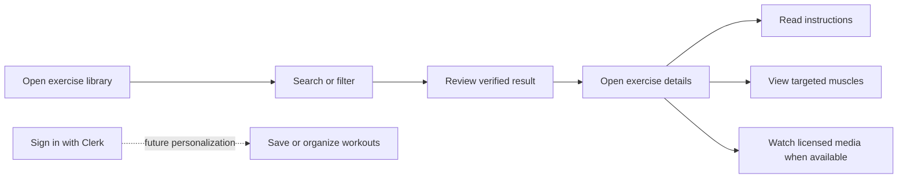
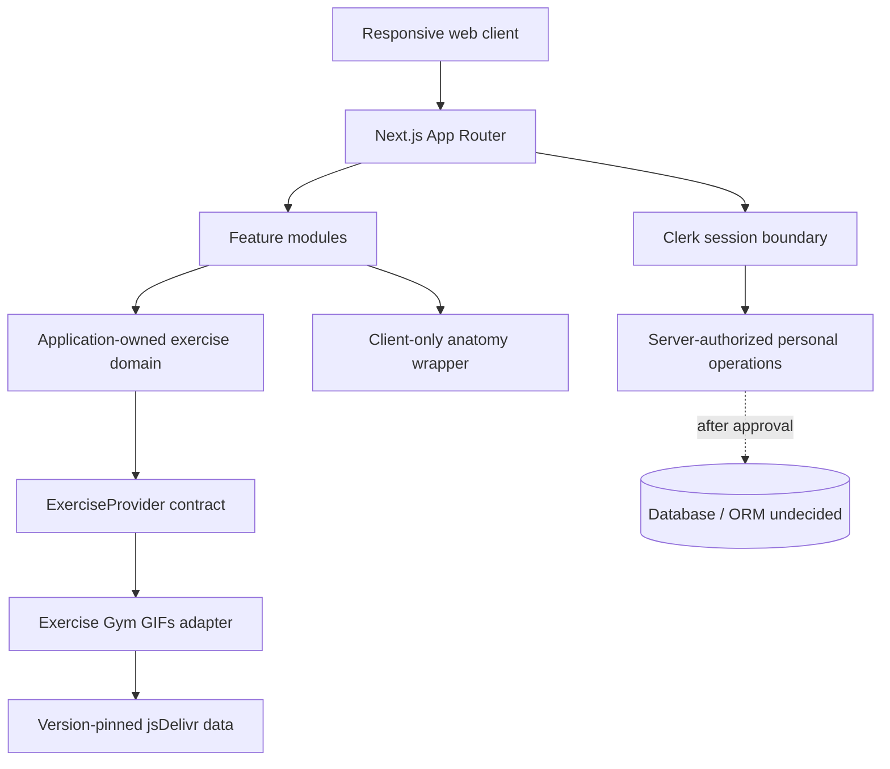

# GYM Fitness Platform

> A planned mobile-first exercise discovery and learning platform built with Next.js. The product name and visual brand are temporary.

## Project status

**Phase 0 — engineering foundation is documented.** The repository currently contains governance and architecture documentation only. No Next.js application has been scaffolded, no dependency is installed, no Clerk tenant or database is configured, and no feature, test, build, or deployment is claimed to work.

| Capability | Status |
| --- | --- |
| Engineering rulebook | Implemented as documentation |
| Architecture and provider design | Documented, not implemented |
| Responsive Next.js application | Planned for Phase 1 |
| Exercise catalog integration | Planned; metadata contract inspected |
| Exercise GIF use | **Blocked for public/commercial release pending rights verification** |
| Clerk authentication | Approved approach, not configured |
| Muscle visualization | Proposed dependency, not installed |
| Database and persistence | Pending developer decision |
| Deployment | Not configured or verified |

The authoritative rules for contributors and coding agents are in [`.agents/README.md`](.agents/README.md). Start with [AGENTS.md](AGENTS.md).

## 1. Mission and vision

GYM Fitness Platform aims to help beginners, intermediate users, and experienced fitness enthusiasts discover exercises, understand technique from verified source material, see which muscles an exercise targets, and eventually organize personal workouts.

The product should feel like a polished fitness guide rather than a generic dashboard: fast on mobile, clear under time pressure, accessible by keyboard and assistive technology, and honest about incomplete source data.

Next.js is the responsive web platform. It is not a native Android or iOS application. The architecture keeps domain contracts independent enough to support a future native client after a separate framework decision.

## 2. Problem

Exercise information is often fragmented across ad-heavy sites, inconsistent names, unexplained anatomy, inaccessible animations, and sources with unclear media rights. Users need one coherent discovery flow that preserves source truth, presents technique accessibly, and avoids inventing difficulty, muscle relationships, or medical claims.

## 3. Intended users

| User | Need |
| --- | --- |
| Beginner | Plain-language discovery, readable steps, understandable muscles and equipment |
| Intermediate trainee | Strong search/facets and efficient exploration |
| Experienced enthusiast | Broad verified catalog and future routine planning |
| Mobile user | Touch-friendly UI and graceful behavior on slow networks |

The platform provides general fitness information, not medical advice, diagnosis, rehabilitation, or guaranteed injury prevention.

## 4. Product capabilities

### MVP

- Responsive exercise library
- Search by exercise name
- Filters for verified body part, muscle, equipment, and category values
- Exercise detail with verified instructions and metadata
- Graceful missing or unavailable media states
- Primary/secondary muscle presentation with an accessible SVG visualization
- Clerk sign-up, sign-in, sessions, account management, and minimal profile onboarding
- Source attribution and provider failure handling

### Future

- Interactive front/back muscle explorer
- Favorites and personal workout plans
- Workout days, sets, repetitions, and rest periods
- Workout history, frequency, and personal goals
- PWA evaluation
- Dedicated native mobile application
- Additional licensed MP4 media providers

### Pending approval

- Database and ORM
- Exact framework/package versions and styling approach (Tailwind CSS is proposed)
- Final route access matrix
- Any paid/RapidAPI integration
- Media licensing solution
- Analytics, notifications, storage, monetization, and hosting beyond the web plan

## 5. Expected journey



Exercise discovery should remain useful when the provider, animation, account service, or a future personalization service is unavailable.

## 6. Technology direction

| Concern | Decision/status |
| --- | --- |
| Framework | Next.js App Router — approved, exact version pending scaffold |
| UI | React — approved, exact version pending scaffold |
| Language | TypeScript with strict settings |
| Authentication | Clerk |
| Exercise source | Exercise Gym GIFs DB behind a provider abstraction |
| Muscle anatomy | React Muscle Highlighter, proposed; MIT code license verified at repository v1.2.0 |
| Styling | Token-driven responsive design; Tailwind CSS proposed, not yet approved |
| Database/ORM | Not selected |
| Deployment | Vercel-compatible; not configured |
| Optional image API | RapidAPI Muscle Group Image Generator; disabled unless separately approved |

No additional service, ORM, auth provider, AI service, component framework, or large dependency should be introduced without a written rationale and developer approval.

## 7. Architecture



Core boundaries:

- **Server Components by default** for route composition, initial reads, metadata, and static presentation.
- **Client Components narrowly** for interactive filters, Clerk widgets where required, and the SVG muscle diagram.
- **Provider isolation:** external JSON is fetched, runtime-validated, normalized, and attributed before UI use.
- **Server Actions:** future authenticated UI mutations only, with authentication, authorization, and validation per action.
- **Route Handlers:** explicit HTTP contracts for future native clients, webhooks, or justified provider facades—not generic business logic containers.
- **Persistence isolation:** no database repository, model, or migration until the database and ORM are approved.

See [`.agents/architecture.md`](.agents/architecture.md) and [`.agents/api.md`](.agents/api.md).

## 8. Normalized exercise contract

The application will own a stable model rather than expose third-party response objects:

| Internal field | Rule |
| --- | --- |
| `id`, `name` | Required after validation |
| `category`, `bodyPart`, `equipment` | Optional canonical enums mapped from verified source values |
| `primaryMuscle` | Optional canonical muscle ID from a verified source field |
| `secondaryMuscles` | Validated canonical list; absence is not a claim of “none” |
| `instructions` | Provider-supported ordered text only |
| `media` | Optional GIF/video/image with URL, type, rights status, and attribution |
| `source` | Provider, source ID, pinned version, and attribution URL |

Difficulty is deliberately absent until an approved source supports it. The UI must never invent missing fields.

## 9. Exercise Gym GIFs DB

The [Exercise Gym GIFs DB repository](https://github.com/JahelCuadrado/ExerciseGymGifsDB) was inspected on 2026-10-27. Its README documents a static English/Spanish JSON API, 19 muscle groups and 1,323 exercises for the inspected release, and a pinned jsDelivr base:

```text
https://cdn.jsdelivr.net/gh/JahelCuadrado/ExerciseGymGifsDB@v1.1.0
```

The documented exercise schema includes `id`, `slug`, `name`, `muscle`, `bodyPart`, `equipment`, `category`, `secondaryMuscles`, `instructions`, `file`, and `gifUrl`. These are provider claims that implementation must validate at runtime; counts and fields must not be treated as permanent.

### Licensing and attribution blocker

The provider README says the GIFs were collected from the internet, the maintainer does not own their copyrights, and the maintainer cannot grant rights to third parties. No repository-wide license file was present in the inspected root listing. Consequently:

- public or commercial use of the GIF collection is not approved;
- the project must not download, commit, self-host, redistribute, proxy, or persistently cache those GIFs;
- public availability through a CDN is not a commercial-use license;
- metadata/code rights also require review before launch;
- development should use first-party/clearly licensed placeholders or developer-approved non-public evaluation only.

This is a release blocker until provenance, license, attribution, embedding/redistribution, and commercial rights are resolved. See [`.agents/exercises.md`](.agents/exercises.md). This documentation is not legal advice.

## 10. Muscle visualization

[React Muscle Highlighter](https://github.com/soroojshehryar/react-muscle-highlighter) was inspected at repository version 1.2.0. Its package declares an MIT license and React 18/19 peer support. It exposes typed front/back anatomy views and a fixed slug set.

Provider and visualization names differ—for example `delts`/`deltoids`, `glutes`/`gluteal`, `quads`/`quadriceps`, and `traps`/`trapezius`. A typed, exhaustively tested mapping layer will translate provider IDs to application IDs and then to highlighter slugs. Unsupported muscles receive a text fallback; unsafe casts or string guessing are forbidden.

The SVG is expected to require a narrow Client Component. A synchronized text/list interface, keyboard operation, visible focus, announced view changes, and non-color labels are required regardless of package claims. See [`.agents/muscle-visualization.md`](.agents/muscle-visualization.md).

## 11. Authentication

Clerk will manage sign-up, sign-in, sessions, and account UI. The installed Clerk version's official App Router documentation must be consulted during implementation.

The recommended route policy keeps exercise discovery public and protects profile, favorites, workouts, and history, but the developer must confirm it. Middleware redirects are not sufficient authorization: every private server operation derives the actor from the Clerk session and owner-scopes access. Profile onboarding stays minimal and avoids unnecessary health data.

## 12. Proposed repository structure

Directories will be created only when implementation requires them:

```text
.
├── AGENTS.md
├── .agents/                    # authoritative engineering rulebook
├── docs/                       # supporting decisions/research as needed
├── public/                     # approved first-party/licensed assets only
└── src/
    ├── app/                    # routes, layouts, route states
    ├── features/
    │   ├── exercises/          # domain, provider adapter, catalog UI
    │   ├── muscle-explorer/    # mapping and anatomy UI
    │   ├── auth/               # Clerk composition and onboarding
    │   └── workouts/           # future; only after persistence approval
    ├── components/ui/          # proven cross-feature primitives
    ├── lib/                    # provider-independent utilities/config
    ├── server/                 # server-only authorization/data operations
    └── types/                  # genuinely cross-domain contracts
```

Routes compose features; features own domain behavior. UI never consumes provider JSON directly. See [`.agents/folder-structure.md`](.agents/folder-structure.md).

## 13. Local development

There is no runnable application yet. Do not run framework, install, lint, test, or build commands against Phase 0 and do not infer missing scripts.

After the developer approves Phase 1, the expected process will be:

1. Select exact Node, Next.js, React, Clerk, styling, and package-manager versions.
2. Scaffold the App Router project using a developer-run approved command.
3. Commit the generated lockfile and tool configuration.
4. Add safe environment example files.
5. Implement a first-party placeholder-backed vertical slice before enabling disputed media.
6. Run the newly defined quality commands and record their actual output.

The Phase 1 task should provide exact commands based on the chosen versions; none are validly specified yet.

## 14. Environment variables

Exact variable names must match installed Clerk/vendor documentation. A future placeholder-only example may resemble:

```dotenv
# Public only when Clerk documents this key as publishable
NEXT_PUBLIC_CLERK_PUBLISHABLE_KEY=pk_test_REPLACE_ME

# Server only — never expose to browser code or commit a real value
CLERK_SECRET_KEY=sk_test_REPLACE_ME
CLERK_WEBHOOK_SECRET=whsec_REPLACE_ME

# Non-secret, pinned provider configuration
EXERCISE_PROVIDER_BASE_URL=https://cdn.jsdelivr.net/gh/JahelCuadrado/ExerciseGymGifsDB@v1.1.0
EXERCISE_PROVIDER_VERSION=v1.1.0
```

No RapidAPI or database variable should be added until that integration is approved. Agents never read or modify real `.env*` values.

## 15. Security and privacy

- Validate all browser and provider input at runtime.
- Build provider paths from allowlisted HTTPS origins and validated identifiers.
- Never forward Clerk/session or profile data to the public exercise CDN.
- Authenticate and authorize each private server operation; derive ownership server-side.
- Keep secrets server-only and error messages free of internals.
- Collect no medical/injury data and minimize fitness preferences/history.
- Do not retain search analytics or add trackers without approval and a privacy review.
- Keep personalized responses out of public caches.

Read [`.agents/security.md`](.agents/security.md), [`.agents/privacy.md`](.agents/privacy.md), and [`.agents/authentication.md`](.agents/authentication.md).

## 16. Accessibility and design quality

The target is WCAG 2.2 AA. Core flows must work with keyboard, touch, zoom/reflow, reduced motion, forced colors, and assistive technology. Animated exercise content requires available written instruction; the anatomy diagram requires a text equivalent. Loading, empty, provider error, malformed data, and missing-media states are first-class product states.

Final visual brand choices remain open. The implementation will use semantic tokens for color, typography, spacing, shape, elevation, and motion, with light/dark compatibility. See [`.agents/design.md`](.agents/design.md) and [`.agents/accessibility.md`](.agents/accessibility.md).

## 17. Testing and quality control

Planned coverage includes:

- unit tests for runtime schemas, normalization, filters, URL construction, and muscle mappings;
- component tests for catalog states, accessible filters, media fallback, and diagram wrapper;
- integration tests for provider success/failure and Clerk-protected owner scope;
- end-to-end tests for browse→filter→detail and later authentication/personal workflows;
- manual keyboard, screen-reader, contrast, motion, mobile, and media checks.

Tests use small synthetic/sanitized fixtures rather than live APIs or copied GIF collections. Agents may write tests but may not execute tests, builds, lint, formatters, or type checks under [`.agents/workflow.md`](.agents/workflow.md).

## 18. Performance and deployment

The application is designed for Vercel-compatible deployment but is not linked or deployed. Initial performance targets use Core Web Vitals “good” thresholds as measurement goals, not current results. Server rendering, bounded data reads, narrow hydration, reserved media space, and controlled animation are preferred.

Production release requires developer-run quality checks, Clerk production verification, security headers, outage/fallback checks, accessibility review, privacy alignment, and approved rights for every exercise asset. The unresolved GIF rights currently block a public release using that media. See [`.agents/performance.md`](.agents/performance.md) and [`.agents/deployment.md`](.agents/deployment.md).

## 19. Roadmap

| Phase | Recommended scope |
| --- | --- |
| 0 — Foundation | Rulebook, architecture, source/licensing research — **documented** |
| 1 — Web shell and vertical slice | Approved scaffold, design tokens, app shell, fixture-backed browse/detail, error states, baseline accessibility |
| 2 — Provider integration | Runtime schemas, pinned adapter, facets/search, caching/error policy; enable only legally approved media |
| 3 — Accounts | Clerk integration, route policy, minimal onboarding |
| 4 — Anatomy | Approved muscle dependency, normalization, accessible diagram/detail integration |
| 5 — Persistence decision | Select database/ORM after requirements and privacy review |
| 6 — Personal workouts | Favorites, plans, sets/reps/rest after persistence approval |
| Later | Progress, PWA evaluation, native client, licensed video providers |

## 20. Known limitations and open decisions

- Final name, branding, typography, and palette are not selected.
- The current workspace is not initialized as a Git repository, so status and diff history are unavailable.
- No application code, dependency manifest, runtime, test harness, or deployment exists.
- Exact package versions and styling solution are undecided.
- The exercise provider's documented schema was inspected, but integration behavior has not been implemented or runtime-validated here.
- Exercise Gym GIF media provenance and commercial rights are unresolved and blocking.
- React Muscle Highlighter accessibility and visuals have not been tested in this project.
- Database, ORM, persistence model, hosting regions, storage, native framework, monetization, paid APIs, and analytics remain undecided.
- RapidAPI is optional and not approved/configured.

## 21. Contributing

Before changing anything:

1. Read [AGENTS.md](AGENTS.md), [`.agents/README.md`](.agents/README.md), [`.agents/workflow.md`](.agents/workflow.md), and [`.agents/project.md`](.agents/project.md).
2. Read every topic rule listed for the task.
3. Inspect current code and installed version-matched documentation.
4. Confirm the task is inside the current phase and approved stack.
5. Keep changes focused; do not silently resolve open decisions or add dependencies.
6. Add applicable tests without executing prohibited commands.
7. Finish with the required completion report and developer-run verification commands.

Commit suggestions follow Conventional Commit style with one explicitly staged file per suggested commit. Agents never perform Git writes. See [`.agents/git.md`](.agents/git.md).

## 22. Reference review

The governance structure was adapted from the accessible [CareBasket repository](https://github.com/kajugadaniels/care-basket), especially its short root agent entry point, authoritative rule index, precedence model, conservative workflow, topic ownership, and truthful completion reporting. CareBasket shopping, family, payment, AI, and hackathon business rules were intentionally not copied.

Reference review date: **2026-10-27**.
